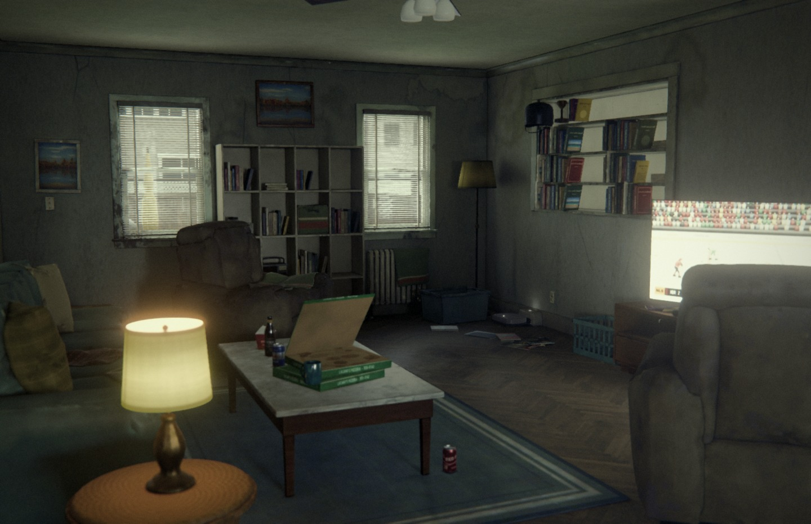
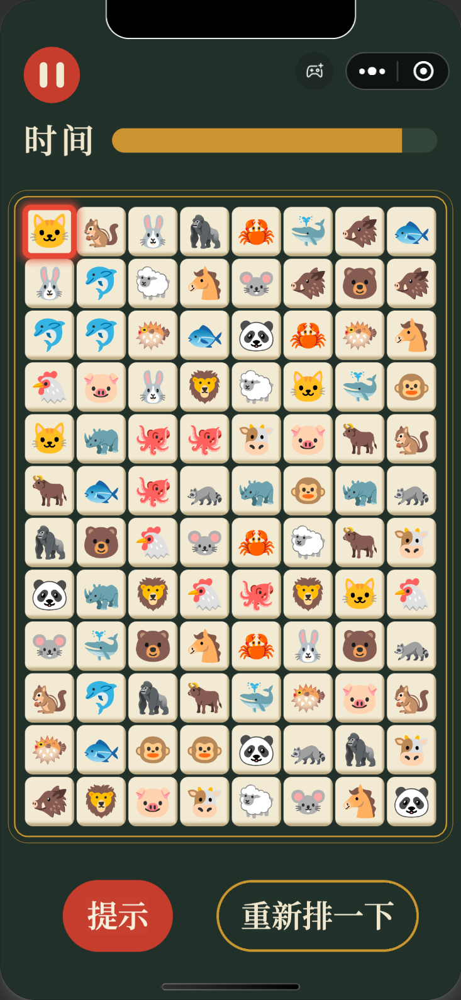
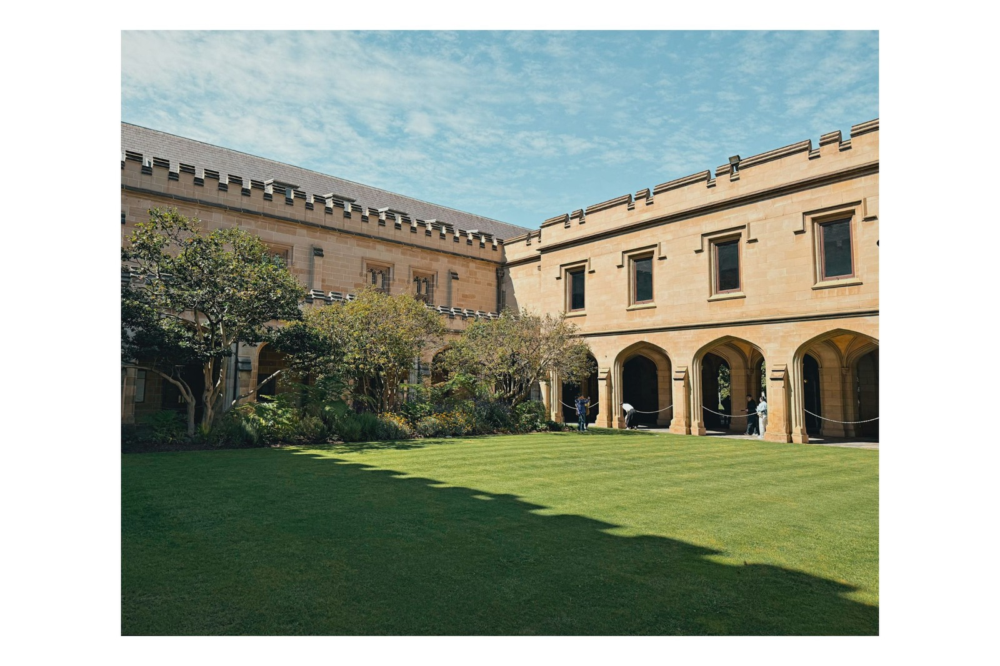
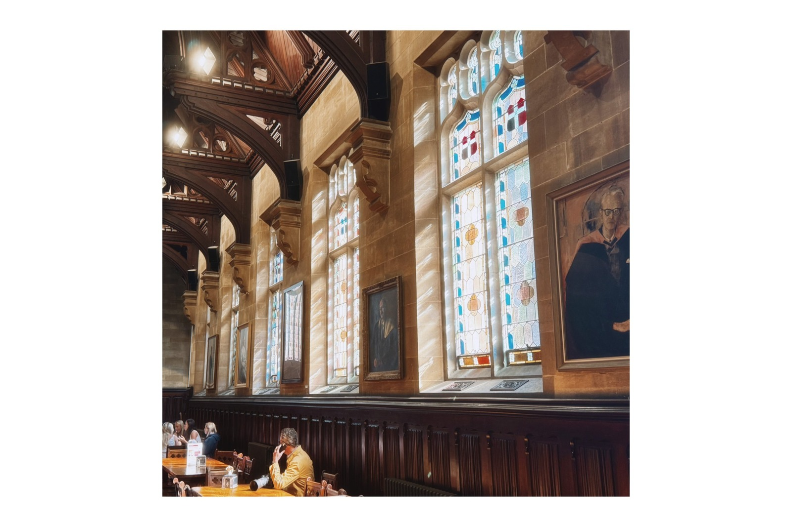

<a href="https://github.com/MoonMere/MoonMere/blob/main/README.zh-CN.md"><kbd>中文</kbd></a>

# Siyuan (Soren) Hou

I'm a Master of Information Technology student at the University of Melbourne. I'm looking for an internship in AI or software development.

Email: [soren.siyuan.hou@gmail.com](mailto:soren.siyuan.hou@gmail.com)

## Personal projects made with AI

I make these with Claude Code, an AI coding tool. I set the direction, and the AI writes the code.

### [Kara and Todd's House from *Detroit: Become Human*](https://github.com/MoonMere/detroit-become-human-kara-todd-house)

An unofficial fan recreation of the house from the game. It contains no assets from the game and is not affiliated with Sony Interactive Entertainment or Quantic Dream. It runs in a web browser, has no commercial purpose and is still a work in progress.

### [外婆爱游戏 (Granny Loves Games)](https://github.com/MoonMere/lianliankan-wechat-game)

A lianliankan (连连看) tile matching game, released on WeChat as a Mini Game.

## Photos

In my spare time, I like taking photos on my phone.

  
  
  
  

More of my photos are in [Phone Photos](https://github.com/MoonMere/phone-photos).
