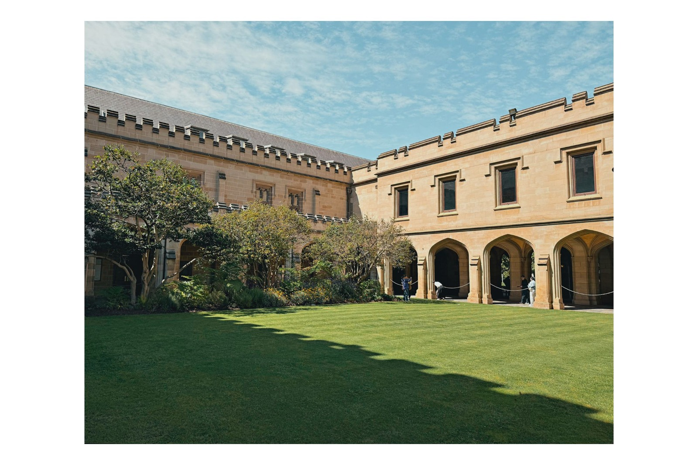
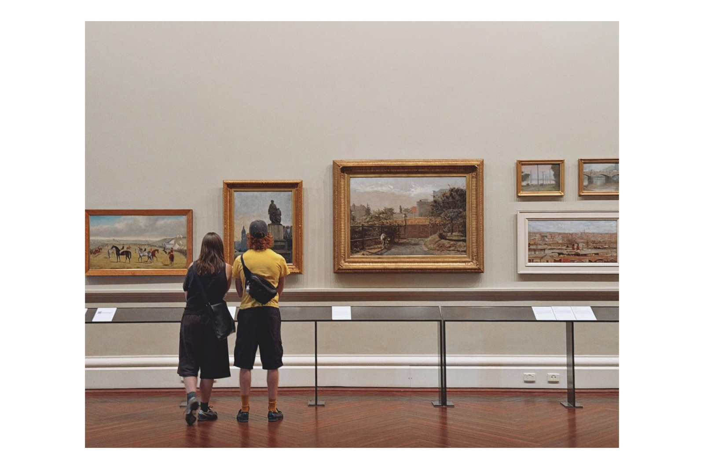
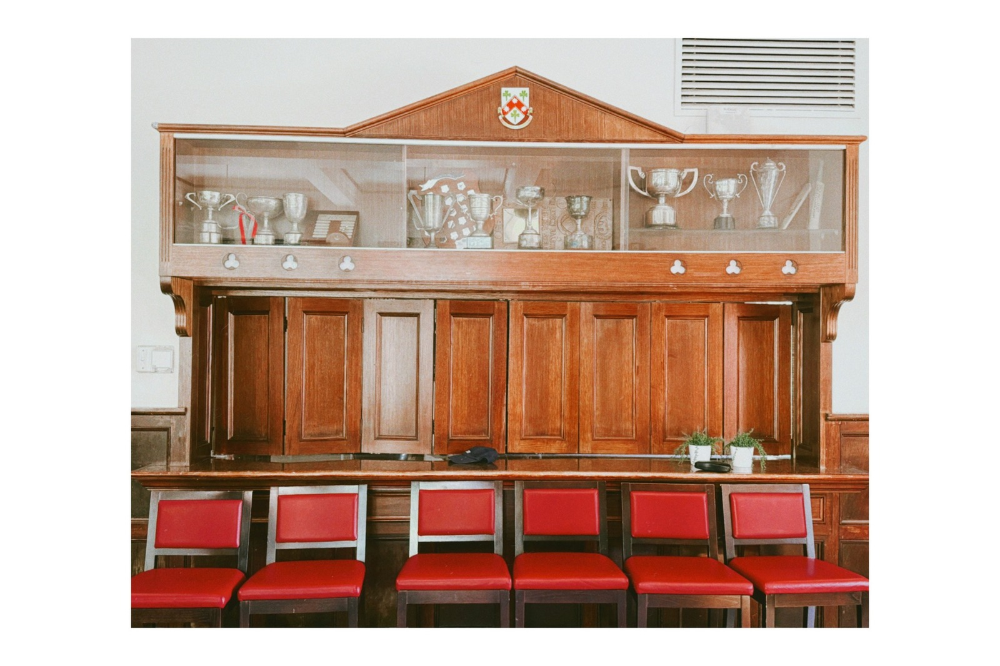
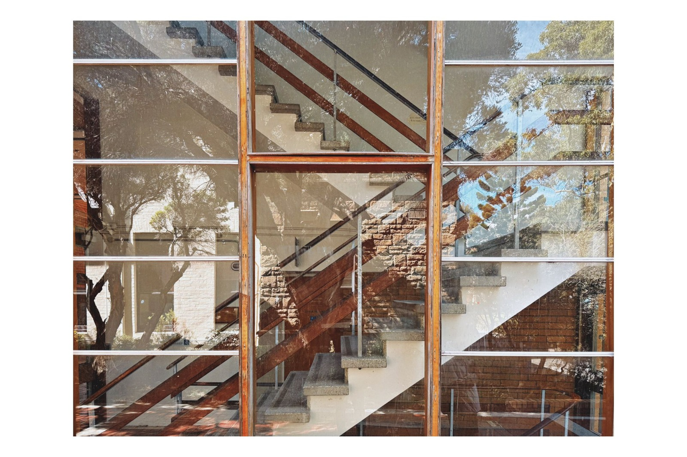

<kbd>中文</kbd>

# 侯思源（Soren）

我在墨尔本大学读信息技术硕士（Master of Information Technology），正在找 AI 或软件开发方向的实习。

邮箱：[soren.siyuan.hou@gmail.com](mailto:soren.siyuan.hou@gmail.com)

我用 Claude Code 做东西。代码由 AI 来写，我决定做什么，并检查做出来的结果。

## 现在的项目

**[LiveNerf 跨 Claude Code 版本对比](https://github.com/MoonMere/livenerf-across-versions)** 
同一个模型，同样的 78 道题，39 个版本的 Claude Code。这个实验看的是，Claude Code 的版本会不会改变 Claude Opus 5.5 答题的好坏，或者它思考的多少。读结果的规则在开跑之前就登记好了，不管结果是什么都会公布。 
2026 年 11 月 · 用 Claude Code 做，主要用的模型是 Claude Fable 5.2

## 做过的其他东西

- **[《底特律：变人》里 Kara 和 Todd 的房子](https://github.com/MoonMere/detroit-become-human-kara-todd-house)**：这栋房子的非官方同人复刻，可以在网页浏览器里走动。没有做完。2026 年 10 月，我先停下它去做别的项目。同月月底，Anthropic 让 Claude Code 不再复刻现有的游戏，我就没有再接着做。 
  2026 年 9 月到 10 月 · 主要用的模型是 Claude Opus 5.5
- **科普视频**，发在 [YouTube](https://www.youtube.com/@MoonMere_H)、[B 站](https://space.bilibili.com/384937924)等平台：面向普通观众的中英文视频，用 AI 做。

## 照片

业余时间，我喜欢用手机拍照。

  
  
  
  

我的更多照片放在[手机照片](https://github.com/MoonMere/phone-photos)里。

<kbd>English</kbd>

# Siyuan (Soren) Hou

I'm a Master of Information Technology student at the University of Melbourne, looking for an internship in AI or software development.

Email: [soren.siyuan.hou@gmail.com](mailto:soren.siyuan.hou@gmail.com)

I build things with Claude Code. The AI writes the code, and I decide what to build and check the results.

## Current project

**[LiveNerf across Claude Code versions](https://github.com/MoonMere/livenerf-across-versions)** 
Same model, same 78 questions, 39 versions of Claude Code. The experiment asks whether the Claude Code version changes how well Claude Opus 5.5 answers, or how much it thinks. The rule for reading the results was registered before the run, and the results will be published whatever they show. 
November 2026 · made with Claude Code, mainly with Claude Fable 5.2

## Other things I've made

- **[Kara and Todd's house from *Detroit: Become Human*](https://github.com/MoonMere/detroit-become-human-kara-todd-house)**: an unofficial fan recreation of the house that you can walk around in a web browser. It is unfinished. I paused it in October 2026 to put other projects first. Later that month, Anthropic told Claude Code to stop recreating existing games, so I did not pick it up again. 
  September to October 2026 · mainly with Claude Opus 5.5
- **Explainer videos** on [YouTube](https://www.youtube.com/@MoonMere_H), [Bilibili](https://space.bilibili.com/384937924) and other platforms: videos in Chinese and English for a general audience, made with AI.

## Photos

In my spare time, I like taking photos on my phone.

  
  
  
  

More of my photos are in [Phone Photos](https://github.com/MoonMere/phone-photos).

